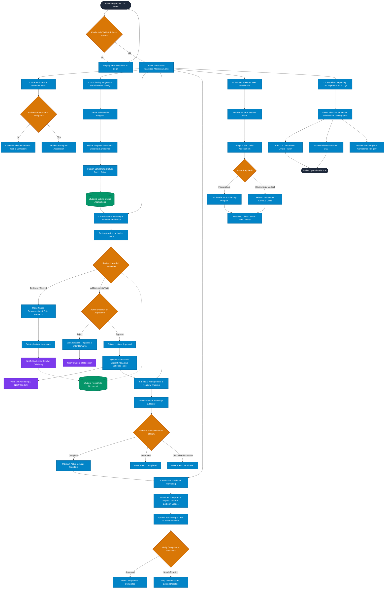
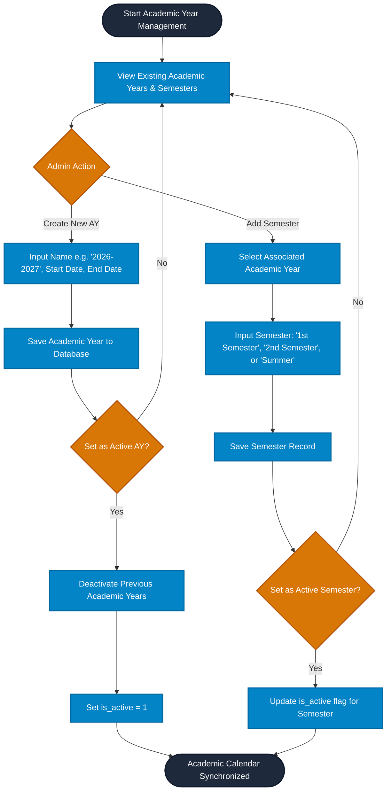
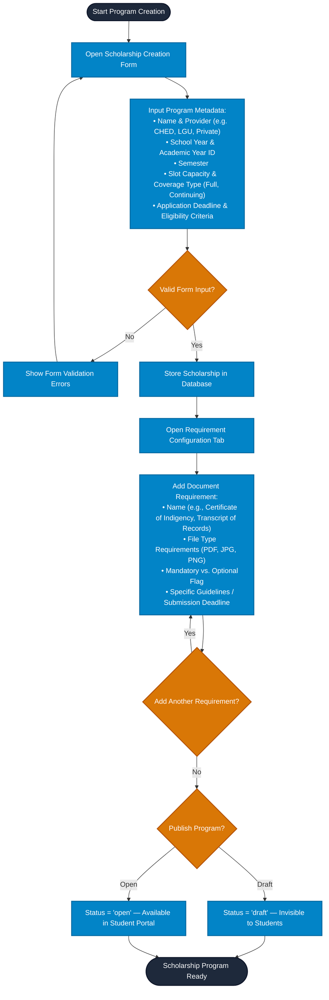
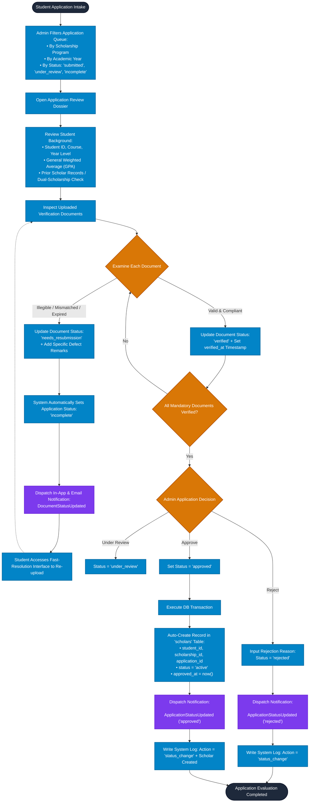
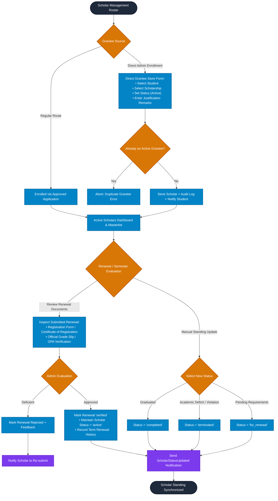
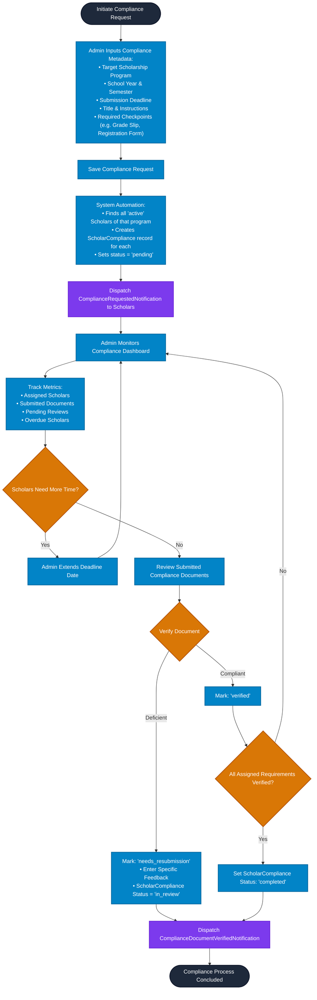
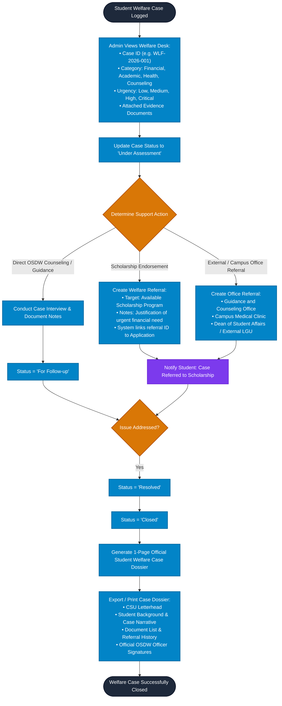
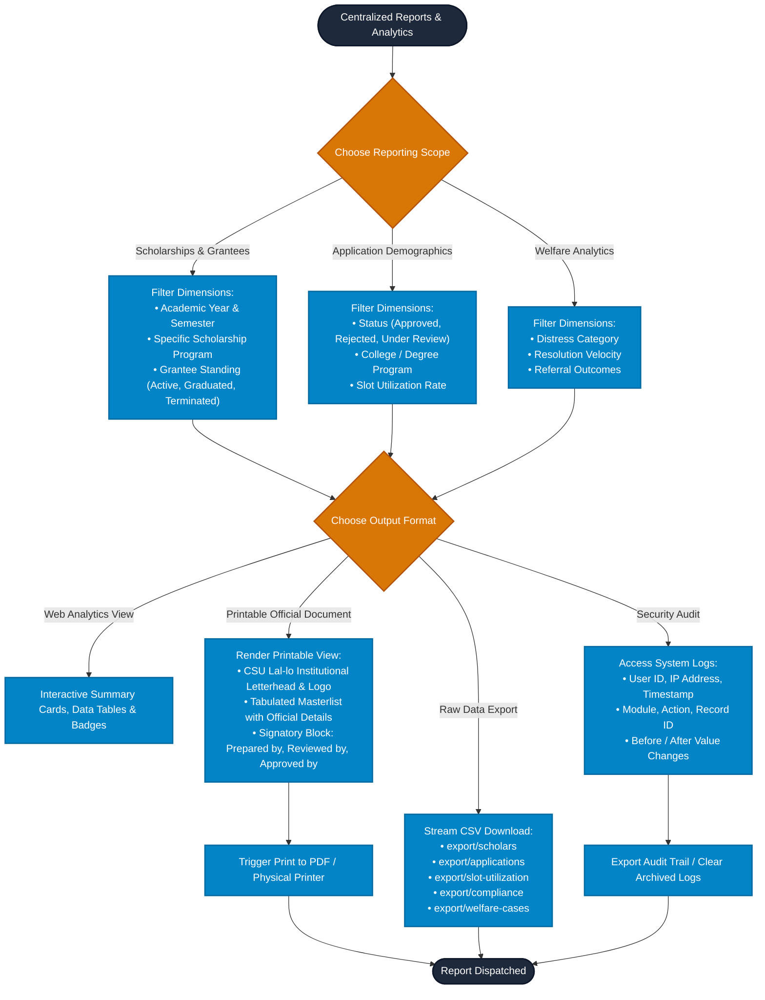

# OSDW Scholarship Management System — Admin-Side Flowcharts & Process Specifications
**Institution:** Cagayan State University (CSU) — Lal-lo Campus  
**Office:** Office of Student Development and Welfare (OSDW)  
**System Module:** Administrator Operations & Grantee Management Portal

---

## 1. High-Level Admin System Architecture & Master Flowchart

The following master flowchart depicts the end-to-end operational lifecycle conducted by the OSDW Administrator, spanning foundation configuration, program launching, application screening, scholar monitoring, periodic compliance, student welfare interventions, and regulatory reporting.

---

## 2. Detailed Process Flowcharts by Administrative Module

### Flowchart 2.1: Academic Year & Semester Configuration
Controls the system-wide active institutional periods that govern scholarship availability and filtering.

---

### Flowchart 2.2: Scholarship Program Creation & Requirement Definition
Defines scholarship programs, funding providers, available slots, coverage types, and document submission checklists.

---

### Flowchart 2.3: Application Review, Document Verification & Enrollment (Core Engine)
Illustrates how the admin processes student submissions, verifies attached proofs, handles deficient documents, and automatically creates scholar records upon approval.

---

### Flowchart 2.4: Active Scholar Management & Renewal Verification
Tracks students after being granted scholarship privileges, managing renewals, semester qualifications, and status transitions.

---

### Flowchart 2.5: Periodic Compliance Monitoring (Midterm / Periodic Checkpoints)
Handles administrative requests for ongoing scholars to submit periodic requirements.

---

### Flowchart 2.6: Student Welfare Case Triage, Referral & Dossier Generation
Manages student development and welfare interventions, emergency student financial assistance, mental health or academic distress referrals, and official dossiers.

---

### Flowchart 2.7: Reporting, Data Export & Audit Trail Architecture
Outlines how aggregated system data is transformed into compliance reports, printable official documents, and immutable security audit logs.

---

## 3. System State Transition Matrix

| Module | Entity | Current State | Triggering Admin Action | Next State | Automated System Side Effects |
| :--- | :--- | :--- | :--- | :--- | :--- |
| **Application** | `Application` | `submitted` | Admin starts reviewing | `under_review` | Updated in queue counters. |
| **Application** | `ApplicationDocument` | `pending` | Admin identifies missing/blurry page | `needs_resubmission` | Application status set to `incomplete`; `DocumentStatusUpdated` notification sent to student. |
| **Application** | `Application` | `incomplete` | Student uploads revised document | `submitted` | Re-enters review queue for admin re-inspection. |
| **Application** | `ApplicationDocument` | `pending` / `needs_resubmission` | Admin validates document authenticity | `verified` | Records `verified_at` timestamp. |
| **Application** | `Application` | `under_review` / `submitted` | Admin approves application | `approved` | **Auto-creates record in `scholars` table** (`status = active`); decrements remaining program slots; sends `ApplicationStatusUpdated` notification; logs in `SystemLog`. |
| **Application** | `Application` | `under_review` / `submitted` | Admin rejects application | `rejected` | If previously enrolled scholar existed, deletes scholar record; sends `ApplicationStatusUpdated` notification with remarks. |
| **Scholar** | `Scholar` | `active` | End of term renewal evaluation | `for_renewal` | Scholar notified to submit renewal documents (Registration Form & Grades). |
| **Scholar** | `Scholar` | `for_renewal` | Admin verifies valid renewal documents | `active` | Renewal history logged for the semester. |
| **Scholar** | `Scholar` | `active` / `for_renewal` | Scholar completes degree | `completed` | Marked as graduate grantee; slot freed for upcoming academic year. |
| **Scholar** | `Scholar` | `active` / `for_renewal` | Grade deficiency / code violation | `terminated` | Disqualified from future disbursements; notification sent. |
| **Compliance** | `ComplianceRequest` | `draft` | Admin publishes request | `active` | System finds all active scholars of program and generates `ScholarCompliance` records with status `pending`; dispatches broadcast notification. |
| **Compliance** | `ScholarCompliance` | `pending` | Scholar submits compliance files | `submitted` | Displays in admin compliance review queue. |
| **Compliance** | `ScholarComplianceDocument`| `pending` | Admin confirms requirement met | `verified` | When all requirements verified, `ScholarCompliance` updates to `completed`. |
| **Welfare** | `WelfareCase` | `Open` | Admin opens case dossier | `Under Assessment` | Staff intake notes recorded. |
| **Welfare** | `WelfareCase` | `Under Assessment` | Admin refers to scholarship or office | `Referred` / `For Follow-up` | Generates `WelfareCaseReferral`; student notified; application linking prepared. |
| **Welfare** | `WelfareCase` | `For Follow-up` | Admin confirms resolution | `Resolved` -> `Closed` | 1-Page Official Case Dossier generated and ready for printing. |

---

## 4. Key Admin Decision Points Summary

1. **Document Verification Gate**:
   - Every uploaded document must be marked as either `verified` or `needs_resubmission`.
   - A single `needs_resubmission` status immediately shifts the entire application to `incomplete`, halting approval until resolved by the student.
2. **Dual-Scholarship Conflict Prevention**:
   - Before approving or manually enrolling a scholar, the system verifies that the student does not hold another active scholarship for the concurrent academic term.
3. **Application Approval Transaction**:
   - The approval of an application is atomic: it updates the application status, registers the scholar grantee, writes the system audit log, and notifies the applicant in a single database transaction.
4. **Welfare Referral to Application Link**:
   - When a student in financial crisis is referred from the Welfare module to a scholarship, the referral ID is tied into the application data (`welfare_case_referral_id`), prioritizing or tracing the scholarship grant back to the welfare case.
