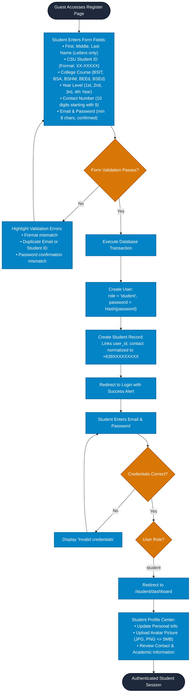
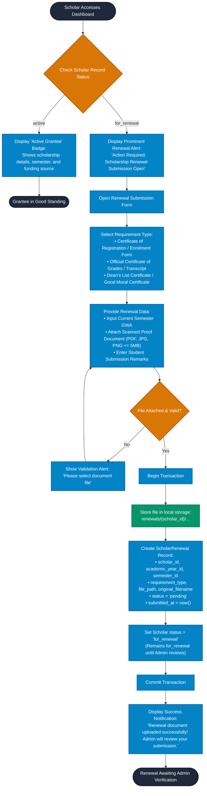
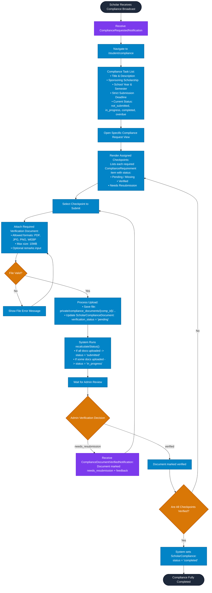
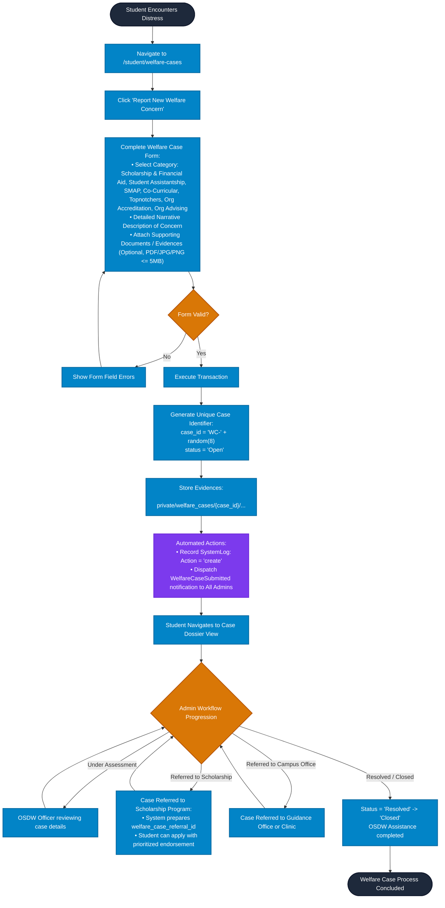

# OSDW Scholarship Management System — Student-Side Flowcharts & Process Specifications
**Institution:** Cagayan State University (CSU) — Lal-lo Campus  
**Office:** Office of Student Development and Welfare (OSDW)  
**System Module:** Student Applicant & Active Grantee Portal

---

## 1. High-Level Student Portal Master Flowchart

The following master flowchart depicts the complete end-to-end journey of a student in the OSDW Scholarship Management System: from registration and application filing, through document defect resolution, to onboarding as an active scholar, term renewals, periodic compliance, and student welfare support.

```mermaid
flowchart TD
    %% Styling
    classDef startEnd fill:#1e293b,stroke:#0f172a,stroke-width:2px,color:#fff;
    classDef process fill:#0284c7,stroke:#0369a1,stroke-width:2px,color:#fff;
    classDef decision fill:#d97706,stroke:#b45309,stroke-width:2px,color:#fff;
    classDef storage fill:#059669,stroke:#047857,stroke-width:2px,color:#fff;
    classDef notify fill:#7c3aed,stroke:#6d28d9,stroke-width:2px,color:#fff;

    Start([Student Visits CSU OSDW Portal]):::startEnd --> HasAccount{Has Student Account?}:::decision

    %% Registration & Login
    HasAccount -- No --> RegisterForm[Register: Input Name, CSU Email, Student ID 'XX-XXXXX', Course, Year Level, Contact]:::process
    RegisterForm --> ValidateReg{Valid & Unique?}:::decision
    ValidateReg -- No --> FixRegErrors[Display Validation Warnings]:::process
    FixRegErrors --> RegisterForm
    ValidateReg -- Yes --> CreateAccount[Store User 'role=student' & Student Profile]:::process
    CreateAccount --> LoginView[Proceed to Login]:::process

    HasAccount -- Yes --> LoginView[Login: Enter Email & Password]:::process
    LoginView --> AuthCheck{Credentials Valid?}:::decision
    AuthCheck -- No --> LoginFail[Display Error Message]:::process
    LoginFail --> LoginView
    AuthCheck -- Yes --> StudentDash[Student Dashboard: Overview, Stats & Badges]:::process

    %% Primary Student Actions from Dashboard
    StudentDash --> NavProfile[Manage Profile & Photo]:::process
    StudentDash --> NavBrowse[Browse Available Scholarships]:::process
    StudentDash --> NavMyApps[Track My Applications]:::process
    StudentDash --> NavScholar[Active Scholar Center: Renewals]:::process
    StudentDash --> NavComp[Fulfill Periodic Compliance]:::process
    StudentDash --> NavWelfare[File Welfare / Emergency Case]:::process
    StudentDash --> NavNotifs[View In-App Notifications]:::notify

    %% Scholarship Discovery & Eligibility
    NavBrowse --> BrowseList[View Open Scholarships List]:::process
    BrowseList --> SelectProg[Open Scholarship Details Page]:::process
    SelectProg --> CheckActiveScholar{Already an Active Scholar?}:::decision

    CheckActiveScholar -- "Yes (Holding Active Grant)" --> LockApplication[Application Prohibited: Rule Prevents Dual Scholarships]:::process
    
    CheckActiveScholar -- "No" --> CheckApplied{Already Applied to Program?}:::decision
    CheckApplied -- Yes --> ShowAlreadyApplied[Show 'Already Applied' Badge]:::process

    CheckApplied -- No --> CheckPeriod{Program Open & Within Deadline?}:::decision
    CheckPeriod -- No --> ShowClosed[Show 'Application Period Closed']:::process

    CheckPeriod -- Yes --> CheckGwa{Student GWA <= Program Max Cutoff?}:::decision
    CheckGwa -- No --> ShowGwaExceeded[Show 'GWA Exceeds Allowed Cutoff']:::process

    %% Application Submission
    CheckGwa -- Yes --> ApplyWizard[Open Multi-Step Application Wizard]:::process
    ApplyWizard --> UploadDocs[Upload Required Documents: PDF, JPG, PNG <= 5MB]:::process
    UploadDocs --> CheckWelfareRef{Linked to Welfare Referral?}:::decision
    CheckWelfareRef -- Yes --> LinkRefID[Attach welfare_case_referral_id]:::process
    CheckWelfareRef -- No --> StandardSubmit[Standard Submission]:::process
    LinkRefID --> SubmitApp[Submit Application]:::process
    StandardSubmit --> SubmitApp

    SubmitApp --> StoreApp[(Save Application 'submitted' & Docs 'pending')]:::storage
    StoreApp --> NotifyParties[Dispatch In-App & Email Notifications to Student & Admins]:::notify

    %% Application Status Tracking & Deficiency Loop
    NotifyParties --> NavMyApps
    NavMyApps --> AppStatusEval{Admin Review Outcome}:::decision

    AppStatusEval -- "Incomplete: Deficient Document" --> DeficientAlert[Receive Deficiency Notification]:::notify
    DeficientAlert --> FastResolution[Open Fast-Resolution Deep Link: /resolve]:::process
    FastResolution --> ReuploadDoc[Upload Replacement Document Files]:::process
    ReuploadDoc --> ResetStatus[Document = 'pending', Application = 'under_review']:::process
    ResetStatus -.-> AppStatusEval

    AppStatusEval -- "Rejected" --> ViewRejection[View Admin Rejection Remarks]:::process

    AppStatusEval -- "Approved" --> EnrolledScholar[Auto-Enrolled as Active Scholar!]:::process

    %% Active Scholar & Renewals
    EnrolledScholar --> NavScholar
    NavScholar --> ScholarStatusCheck{Standing Status}:::decision

    ScholarStatusCheck -- "for_renewal" --> RenewalAlert[Submit Renewal: Grade Slip & Certificate of Reg]:::process
    RenewalAlert --> SubmitRenewalDoc[(Upload Renewal File & Input GPA)]:::storage
    SubmitRenewalDoc --> AdminVerifyRenewal[Awaiting Admin Renewal Verification]:::process

    %% Periodic Compliance
    StudentDash --> NavComp
    NavComp --> CompList[View Assigned Compliance Requests]:::process
    CompList --> CompShow[Open Compliance Task: Check Deadline]:::process
    CompShow --> UploadCompDoc[Upload Specific Required Documents]:::process
    UploadCompDoc --> CompStatusUpdate[Status Automatically Recalculates: Submitted / Completed]:::process

    %% Welfare
    StudentDash --> NavWelfare
    NavWelfare --> FileCaseForm[Describe Distress Concern & Attach Evidence]:::process
    FileCaseForm --> CaseSubmitted[Case Assigned Unique ID 'WC-XXXXXXXX']:::process
    CaseSubmitted --> TrackCaseStatus[Track Admin Triage: Under Assessment -> Referred -> Resolved]:::process

    LockApplication --> StudentDash
    ShowAlreadyApplied --> StudentDash
    ViewRejection --> Finish([Session Complete]):::startEnd
    AdminVerifyRenewal --> Finish
    CompStatusUpdate --> Finish
    TrackCaseStatus --> Finish
```



---

## 2. Detailed Process Flowcharts by Student Module

### Flowchart 2.1: Student Registration, Profile & Authentication
Covers student account onboarding, input validation (Student ID format `XX-XXXXX`, CSU phone number `9XXXXXXXXX`), and profile management.



---

### Flowchart 2.2: Scholarship Program Discovery & Eligibility Verification
Governs how students browse programs and how the system prevents non-compliant or dual-scholarship submissions before they can apply.

```mermaid
flowchart TD
    classDef startEnd fill:#1e293b,stroke:#0f172a,stroke-width:2px,color:#fff;
    classDef process fill:#0284c7,stroke:#0369a1,stroke-width:2px,color:#fff;
    classDef decision fill:#d97706,stroke:#b45309,stroke-width:2px,color:#fff;

    Start([Student Opens /student/scholarships]):::startEnd --> QueryPrograms["System Fetches Available Scholarships:
    • status = 'open'
    • application_start_date <= Today
    • application_deadline >= Today"]:::process

    QueryPrograms --> DisplayCards[Render Scholarship Cards with Deadlines & Slots]:::process
    DisplayCards --> SearchFilter{Student Uses Search?}:::decision
    SearchFilter -- Yes --> ApplySearch[Filter by Program Name or Funding Provider]:::process
    ApplySearch --> DisplayCards
    SearchFilter -- No --> SelectProgram[Student Clicks Program Card]:::process

    SelectProgram --> OpenDetailsView[View Program Guidelines & Checklist]:::process
    OpenDetailsView --> CheckDualGrant{Student hasActiveScholarship()?}:::decision

    CheckDualGrant -- Yes --> LockApplyBtn["Display Warning Banner:
    'You are already an active grantee of another scholarship.
    Dual scholarships are not permitted.'
    • Hide/Disable 'Apply Now' Button"]:::process

    CheckDualGrant -- No --> CheckPriorSubmission{Has Existing Application for Program?}:::decision
    CheckPriorSubmission -- Yes --> ShowSubmittedBadge["Display Status Badge:
    'Already Applied'
    • Link to Application Tracker"]:::process

    CheckPriorSubmission -- No --> CheckDeadlinePassed{Deadline Passed?}:::decision
    CheckDeadlinePassed -- Yes --> ShowClosedBadge["Display Status Badge:
    'Application Closed'"]:::process

    CheckDeadlinePassed -- No --> CheckGwaCutoff{Program Has Min GWA Requirement?}:::decision
    CheckGwaCutoff -- Yes --> CompareGwa{Student GWA <= Program Cutoff?}:::decision
    CompareGwa -- No --> ShowIneligibleGwa["Display Warning:
    'Current GWA does not meet minimum cutoff requirement'"]:::process
    CompareGwa -- Yes --> UnlockApplyBtn[Enable 'Apply Now' Button]:::process
    CheckGwaCutoff -- No --> UnlockApplyBtn

    UnlockApplyBtn --> ClickApply[Student Clicks 'Apply Now']:::process
    ClickApply --> RouteWizard[Navigate to /scholarships/{id}/apply]:::process

    LockApplyBtn --> EndBrowsing([Browsing Complete]):::startEnd
    ShowSubmittedBadge --> EndBrowsing
    ShowClosedBadge --> EndBrowsing
    ShowIneligibleGwa --> EndBrowsing
    RouteWizard --> EndBrowsing
```

---

### Flowchart 2.3: Multi-Step Application Submission & Document Upload
Covers the application wizard, mandatory document uploads, automatic linking with welfare referrals, and dual-party notifications.

```mermaid
flowchart TD
    classDef startEnd fill:#1e293b,stroke:#0f172a,stroke-width:2px,color:#fff;
    classDef process fill:#0284c7,stroke:#0369a1,stroke-width:2px,color:#fff;
    classDef decision fill:#d97706,stroke:#b45309,stroke-width:2px,color:#fff;
    classDef storage fill:#059669,stroke:#047857,stroke-width:2px,color:#fff;
    classDef notify fill:#7c3aed,stroke:#6d28d9,stroke-width:2px,color:#fff;

    Start([Enter Application Form]):::startEnd --> PrecheckSecurity{Server-Side Preconditions Pass?}:::decision
    PrecheckSecurity -- "Dual Scholar / Closed / Duplicate" --> AbortRedirect[Abort with Error Redirect]:::process

    PrecheckSecurity -- "Valid" --> LoadChecklist[Load Active Document Requirements for Scholarship]:::process
    LoadChecklist --> DisplayForm["Render Application Form:
    • Display Pre-filled Student Info (GWA, Course, Year)
    • Render File Upload Input for Each Requirement:
      - Certificate of Indigency / Proof of Income
      - Certificate of Grades / Transcript of Records
      - Certificate of Registration (COR)
      - Valid Student ID / Barangay Clearance"]:::process

    DisplayForm --> StudentUploads[Student Selects Document Files from Device]:::process
    StudentUploads --> SubmitFormClick[Student Submits Application]:::process

    SubmitFormClick --> ValidateFiles{Validate Uploaded Files}:::decision
    ValidateFiles -- "Missing Required Doc / Invalid MIME / >5MB" --> ShowFileErrors[Highlight Specific File Input Errors]:::process
    ShowFileErrors --> DisplayForm

    ValidateFiles -- "All Files Valid" --> CheckWelfareReferral{Check for Active Welfare Case Referral?}:::decision
    
    CheckWelfareReferral -- Yes --> FindReferral["Query WelfareCaseReferral:
    Find matching referral for this student and program"]:::process
    FindReferral --> SetRefID[Set welfare_case_referral_id]:::process
    
    CheckWelfareReferral -- No --> SetRefNull[Set welfare_case_referral_id = null]:::process

    SetRefID --> DBStoreTx[Begin DB Transaction]:::process
    SetRefNull --> DBStoreTx

    DBStoreTx --> CreateAppRow["Create Application Record:
    • student_id, scholarship_id, welfare_case_referral_id
    • status = 'submitted'
    • submitted_at = now()"]:::process

    CreateAppRow --> StoreFilesLoop["For Each Uploaded Requirement:
    • Store file securely: private/documents/{app_id}/...
    • Create ApplicationDocument:
      status = 'pending', verification_status = 'pending'"]:::storage

    StoreFilesLoop --> CommitTx[Commit DB Transaction]:::process
    CommitTx --> DispatchNotifs["Dispatch ApplicationSubmittedNotification:
    • In-App Notification to Student User
    • Email & In-App Notification to All Admin Accounts"]:::notify

    DispatchNotifs --> SuccessRedirect["Redirect to /student/applications
    with Success Flash Alert"]:::process

    SuccessRedirect --> EndAppSubmit([Application In Review Queue]):::startEnd
```



---

### Flowchart 2.4: Fast Deficiency Resolution Loop (Fixing Deficient Documents)
Details the swift recovery process when an admin marks an uploaded document as `needs_resubmission`.

```mermaid
flowchart TD
    classDef startEnd fill:#1e293b,stroke:#0f172a,stroke-width:2px,color:#fff;
    classDef process fill:#0284c7,stroke:#0369a1,stroke-width:2px,color:#fff;
    classDef decision fill:#d97706,stroke:#b45309,stroke-width:2px,color:#fff;
    classDef notify fill:#7c3aed,stroke:#6d28d9,stroke-width:2px,color:#fff;

    Start([Admin Flags Document Defect]):::startEnd --> TriggerDefect["Admin sets document status:
    'needs_resubmission' + Remarks"]:::process
    
    TriggerDefect --> AutoIncomplete["System sets Application status:
    'incomplete'"]:::process

    AutoIncomplete --> NotifyStudent["Student receives DocumentStatusUpdated notification
    with Direct Resolution Link"]:::notify

    NotifyStudent --> StudentActionChoice{Where does Student open resolution?}:::decision
    StudentActionChoice -- "Notification Click" --> DeepLinkRoute[Navigate to /applications/{id}/resolve]:::process
    StudentActionChoice -- "Application Tracker" --> TrackerRoute["Click 'Resolve Incomplete Documents' Button"]:::process
    TrackerRoute --> DeepLinkRoute

    DeepLinkRoute --> LoadDeficientDocs["Render Fast-Resolution Interface:
    • Displays ONLY Deficient Documents
    • Shows Officer's Specific Remarks (e.g. 'Blurry signature, re-upload page 2')
    • Single replacement file upload input per defect"]:::process

    LoadDeficientDocs --> SelectNewFiles[Student Attaches Clear Replacement Files]:::process
    SelectNewFiles --> SubmitReplacement[Click 'Resubmit Documents']:::process

    SubmitReplacement --> ValidateReplacement{Files Valid (PDF/JPG/PNG <= 5MB)?}:::decision
    ValidateReplacement -- No --> ShowReplaceErrors[Show File Validation Error]:::process
    ShowReplaceErrors --> LoadDeficientDocs

    ValidateReplacement -- Yes --> OverwriteDocs["Process Replacement:
    • Store new file to private/documents/{app_id}/...
    • Update ApplicationDocument:
      - file_path = new_path
      - status = 'pending'
      - verification_status = 'pending'
      - remarks = null"]:::process

    OverwriteDocs --> AutoReturnReview["System updates Application status:
    'under_review'"]:::process

    AutoReturnReview --> SuccessFeedback["Redirect to Application Details
    with Success Flash Notice:
    'Documents successfully replaced! Now under OSDW review.'"]:::process

    SuccessFeedback --> EndDeficiencyLoop([Back in Admin Review Queue]):::startEnd
```

---

### Flowchart 2.5: Active Scholar Term Renewal Submission
Governs the renewal process for existing scholars at the beginning of each semester or when standing is flagged as `for_renewal`.



---

### Flowchart 2.6: Periodic Compliance Fulfillment (Active Scholars)
Handles scholar compliance with administrative broadcast requests (e.g., midterm grade submissions, community involvement proof).



---

### Flowchart 2.7: Student Welfare Case Filing & Referral Tracking
Empowers students experiencing financial, academic, psychological, or family distress to submit welfare cases and track OSDW interventions.



---

## 3. Student State Transition Matrix & Pre-Qualification Rules

### State Transitions (Student Lifecycle)

| Entity | Current Status | Student Action / Event | Target Status | System Automated Side Effects |
| :--- | :--- | :--- | :--- | :--- |
| **User / Student** | *Unregistered* | Submits `/register` form | *Active Student* | Creates `User` and `Student` records; normalizes contact number to `+63`. |
| **Application** | *Not Applied* | Submits `/apply` form with required files | `submitted` | Stores files securely; creates `ApplicationDocument` records; sends notifications to student and admins. |
| **Application** | `submitted` | Admin starts review | `under_review` | Visible on student application tracking page. |
| **ApplicationDocument**| `pending` | Admin flags defect / blurry file | `needs_resubmission` | Application status set to `incomplete`; dispatches `DocumentStatusUpdated` notification with deep link. |
| **Application** | `incomplete` | Student re-uploads via `/resolve` | `under_review` | Deficient documents reset to `pending`; application returns to admin queue. |
| **Application** | `under_review` | Admin grants approval | `approved` | **Auto-enrolled into `scholars` table as `active`**; student notified. |
| **Application** | `under_review` | Admin denies application | `rejected` | Remarks displayed; student notified. |
| **Scholar** | `active` | Term concludes / renewal period starts | `for_renewal` | Renewal banner activated on student dashboard. |
| **Scholar** | `for_renewal` | Student uploads grade slip & COR | `for_renewal` | Creates `ScholarRenewal` (`status = pending`); awaits admin verification. |
| **Scholar** | `for_renewal` | Admin verifies renewal documents | `active` | Continued scholarship coverage confirmed. |
| **ScholarCompliance** | `not_submitted` | Compliance request published | `not_submitted` | Student notified via `ComplianceRequestedNotification`. |
| **ScholarCompliance** | `not_submitted` | Student uploads first document | `in_progress` | Real-time progress bar recalculation. |
| **ScholarCompliance** | `in_progress` | Student uploads all required files | `submitted` | Awaiting admin verification. |
| **ScholarCompliance** | `submitted` | Admin verifies all documents | `completed` | Compliance requirement satisfied. |
| **WelfareCase** | *None* | Student submits distress ticket | `Open` | Unique `WC-XXXXXXXX` ID generated; all admins notified. |

---

### Core Student Business Rules

1. **Dual Scholarship Strict Prohibition**:
   - Students holding an `active` scholar record cannot apply for another scholarship program. The system automatically hides the apply button and displays a warning banner.
2. **Duplicate Application Prevention**:
   - A student can only submit one application per scholarship program. Subsequent attempts are blocked with an "Already Applied" indicator.
3. **Prequalification Cutoffs**:
   - The application wizard validates the student's General Weighted Average (GWA) against the program's maximum allowable cutoff before granting form access.
4. **Fast Deficiency Resolution**:
   - Students can resolve document deficiencies without re-uploading the entire application. Only the deficient files are requested via the `/resolve` deep link.
5. **Private Document Storage**:
   - All student documents (grades, certificates of indigency, medical proofs) are stored in private disks and served through authenticated streaming routes (`viewSecureDocument`) to protect student privacy.
